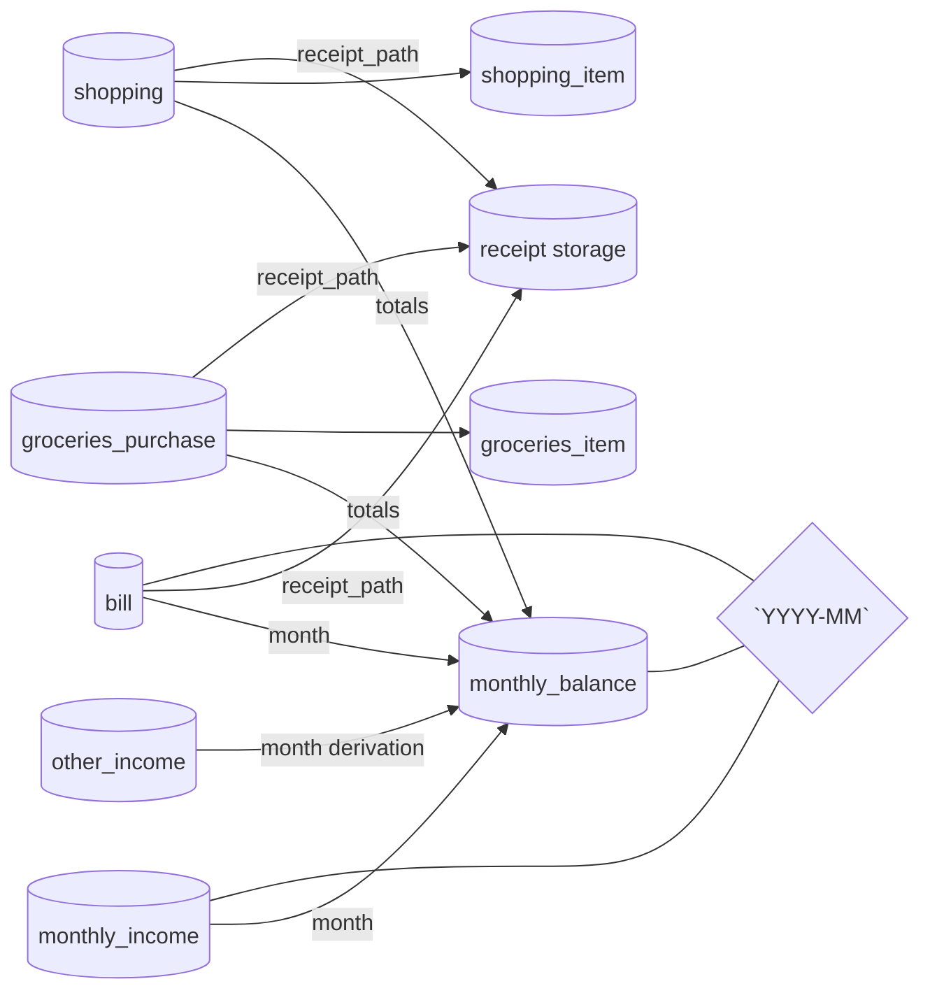

# HomePlanner

Spring Boot application for managing incomes, bills, shopping and groceries.
Supports file uploads for receipts and provides monthly snapshot and forecast endpoints.

## Requirements

- Java 21
- Maven
- MySQL 8+

## Running

Configure the database connection and optional receipt storage directory in `src/main/resources/application.properties` and start the application:

```
mvn spring-boot:run
```

API documentation is available at `http://localhost:8080/swagger-ui.html` once the application is running.

### Key Endpoints

- `/api/monthly-income` – manage monthly income
- `/api/other-income` – manage other income
- `/api/bills` – manage bills and upload receipts
- `/api/groceries` – track groceries purchases and items
- `/api/shopping` – track shopping trips and items
- `/api/monthly-balance` – store monthly balances
- `/api/snapshot/{month}` – view monthly snapshot
- `/api/forecast/{month}` – view simple forecast

## Database design overview



The diagram highlights the entities already implemented in the service:

- Income tables (`monthly_income`, `other_income`) capture recurring and ad-hoc inflows.
- `monthly_balance` references the shared `YYYY-MM` domain to store the computed leftover per month.
- Expense tables (`bill`, `groceries_purchase`, `shopping`) feed the balance calculations, while `groceries_item` and `shopping_item` retain line-level detail under their parent purchases.
- All bill, grocery, and shopping rows may carry a `receipt_path` pointing at the receipt storage service directory configured via `receipts.dir`.

